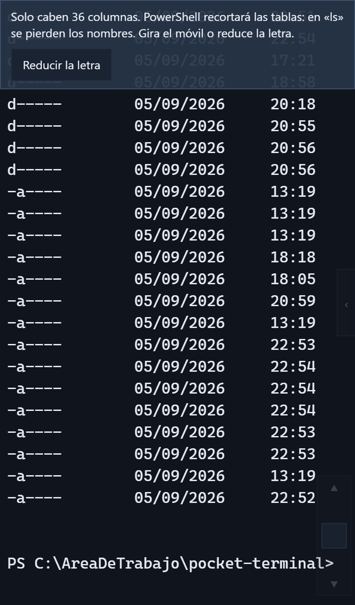
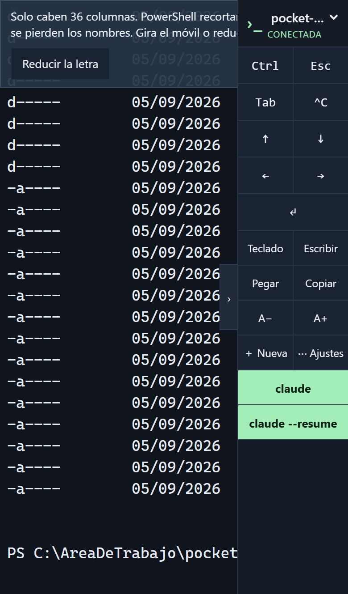
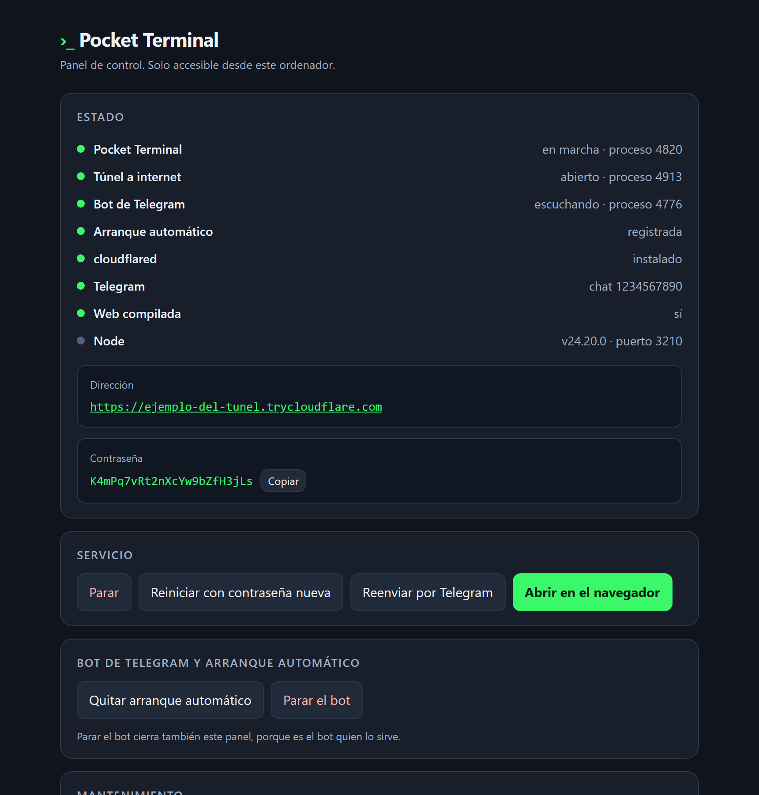
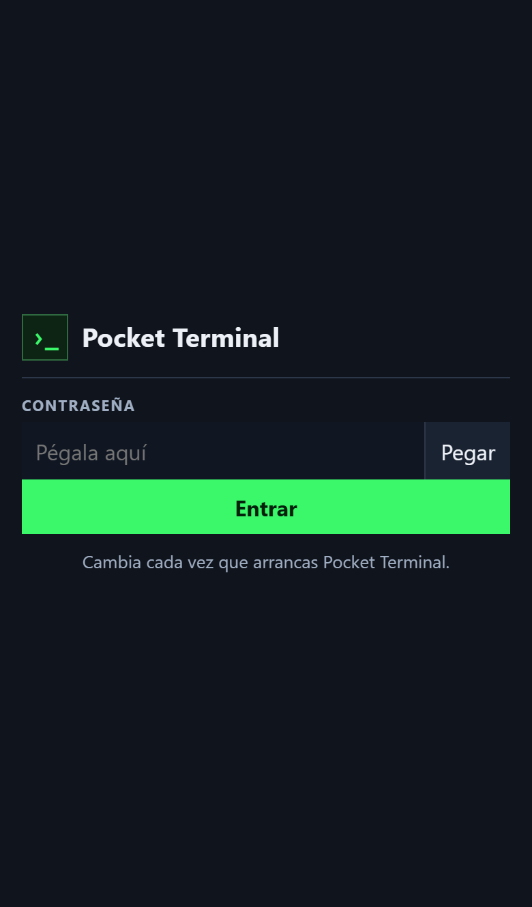
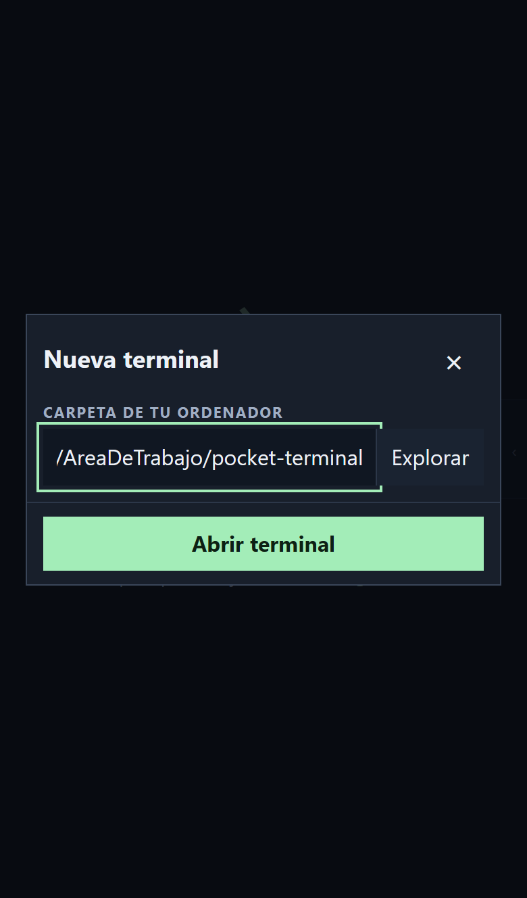
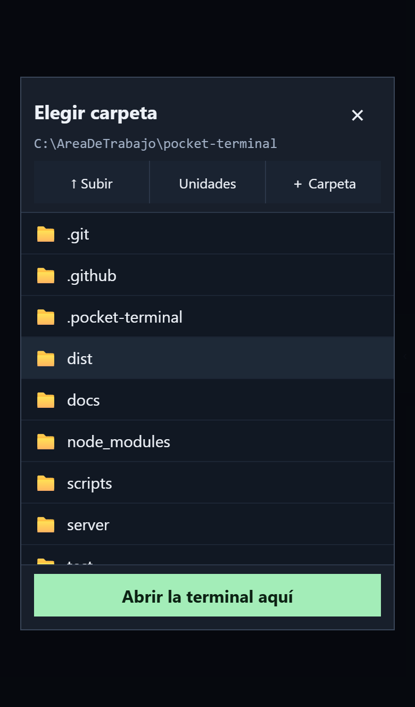
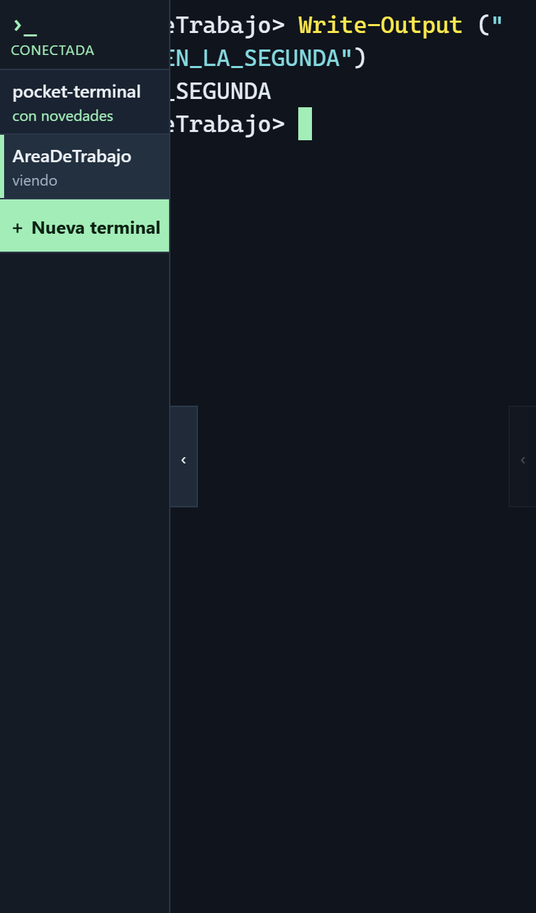

<div align="center">

# Pocket Terminal

**Tu terminal de Windows, de verdad, en el móvil.**

PowerShell real en tu ordenador, con `claude`, `git` y `ssh`, manejado desde el teléfono.
Lo enciendes por Telegram, entras por una dirección HTTPS y sigues donde lo dejaste.

</div>

<div align="center">

&nbsp;&nbsp;

</div>

---

## Índice

- [Qué es y qué no es](#qué-es-y-qué-no-es)
- [Cómo funciona](#cómo-funciona)
- [Instalación](#instalación)
- [Encenderlo desde el móvil](#encenderlo-desde-el-móvil)
- [Uso diario](#uso-diario)
- [El ancho importa](#el-ancho-importa)
- [Decisiones y mediciones](#decisiones-y-mediciones)
- [Seguridad](#seguridad)
- [Configuración](#configuración)
- [Desarrollo](#desarrollo)

---

## Qué es y qué no es

**Es** una terminal real de tu Windows, servida a tu móvil. El texto se ajusta a las columnas del teléfono, las terminales sobreviven a que cierres el navegador o pierdas cobertura, y el bot de Telegram enciende y apaga el servicio sin que toques el ordenador.

**No es** un escritorio remoto ni una máquina en la nube. Todo corre en tu PC con tu usuario. Si el ordenador está apagado, no hay terminal.

**Para quién**: una persona y sus propios dispositivos. No es una plataforma para dar terminales a terceros.

## Cómo funciona

```
   iPhone                    Internet                 Tu Windows
┌──────────┐            ┌───────────────┐        ┌──────────────────┐
│  la web  │◄──HTTPS───►│  túnel        │◄──────►│  servidor  :3210 │
│  xterm   │◄──WSS─────►│  (cloudflared)│        │       │          │
└──────────┘            └───────────────┘        │       ▼          │
      ▲                                          │  PowerShell      │
      │                 ┌───────────────┐        │  (ConPTY)        │
      └───órdenes──────►│   Telegram    │◄──────►│  bot      :3211  │
          y avisos      └───────────────┘        │  panel de control│
                                                 └──────────────────┘
```

Tres piezas, cada una con un trabajo:

| Pieza | Qué hace | Dónde vive |
|---|---|---|
| **Servidor** | Abre PowerShell en una terminal real y la sirve por WebSocket | Tu PC, puerto 3210 |
| **Bot** | Enciende y apaga el servicio desde Telegram, y sirve el panel de control | Tu PC, puerto 3211 |
| **Túnel** | Da una dirección HTTPS pública sin abrir puertos en el router | Proceso aparte |

El bot escucha desde que inicias sesión en Windows. El servidor y el túnel, solo cuando los enciendes.

---

## Instalación

**Requisitos**: Windows 11 x64, [Node.js 24 LTS](https://nodejs.org/en/download) y [Git para Windows](https://git-scm.com/downloads/win). Windows 10 reciente tiene ConPTY, pero no se valida aquí cada versión. Windows ARM64 no está verificado.

```powershell
git clone https://github.com/Dasge97/pocket-terminal.git
cd pocket-terminal
powershell -NoProfile -ExecutionPolicy Bypass -File .\scripts\Setup.ps1
```

El asistente instala dependencias, compila la web y pregunta la carpeta inicial, la dirección de acceso y la contraseña. La contraseña no se muestra al escribirla y solo se guarda un hash con sal.

Después, **cloudflared**, que es lo que da la dirección HTTPS. No necesita permisos de administrador:

```powershell
New-Item -ItemType Directory -Force "$env:LOCALAPPDATA\cloudflared" | Out-Null
Invoke-WebRequest -Uri "https://github.com/cloudflare/cloudflared/releases/latest/download/cloudflared-windows-amd64.exe" -OutFile "$env:LOCALAPPDATA\cloudflared\cloudflared.exe" -UseBasicParsing
```

<details>
<summary><b>Si falla la instalación de node-pty</b></summary>

`node-pty` tiene componentes nativos. Si no hay un binario compatible, necesita compilarse. Instala Python 3 y Visual Studio 2022 Build Tools con **Desarrollo para el escritorio con C++**, MSVC y Windows SDK. Si aparece `MSB8040`, añade las bibliotecas MSVC con mitigación Spectre. Después vuelve a ejecutar `Setup.ps1`.

Referencias: [node-pty](https://github.com/microsoft/node-pty#dependencies) y [node-gyp para Windows](https://github.com/nodejs/node-gyp#on-windows).
</details>

<details>
<summary><b>Comprobar que claude, git y ssh funcionan</b></summary>

En PowerShell normal:

```powershell
claude --version
git --version
ssh -V
```

Si solo usabas Claude como extensión de VS Code, instala su [CLI oficial](https://code.claude.com/docs/en/setup) e inicia sesión una vez. Pocket Terminal no añade suscripción ni llama a la API por su cuenta: usa la autenticación que ya tiene Claude Code.

PowerShell hereda el usuario, las variables y el perfil del proceso del servidor. Reinicia Pocket Terminal si instalas herramientas o cambias el PATH.
</details>

## Encenderlo desde el móvil

Crea un bot hablando con [@BotFather](https://t.me/BotFather), envíale `/newbot` y guarda el token. Después:

```powershell
npm.cmd run telegram
```

Pide el token sin mostrarlo al escribir y enseña un **código de vinculación** de ocho caracteres. Mándale ese código al bot **por privado** dentro de cinco minutos. Solo queda autorizada la cuenta que envía el código, y a partir de ahí el bot no obedece a nadie más ni en ningún grupo.

Luego deja el bot escuchando desde que inicias sesión en Windows:

```powershell
powershell -NoProfile -ExecutionPolicy Bypass -File .\scripts\Enable-BotAutostart.ps1
```

A partir de ahí, todo desde el chat:

| Orden | Qué hace |
|---|---|
| `/arrancar` | Abre el túnel, enciende el servidor y te manda dirección y contraseña |
| `/parar` | Cierra el servidor y el túnel |
| `/reiniciar` | Lo para y lo vuelve a abrir, con dirección y contraseña nuevas |
| `/estado` | Dice si está en marcha y repite los datos |

Con la dirección llegan cuatro botones para esas mismas cuatro acciones, así que no hace falta teclear nada.

> **Un bot de Telegram es público: cualquiera puede escribirle.** Pocket Terminal solo obedece a la cuenta vinculada y solo por mensaje privado; descarta el resto sin contestar, de modo que un desconocido no recibe respuesta alguna.

> **Tu cuenta de Telegram es parte de la seguridad del ordenador.** Quien pueda usarla puede pedir `/arrancar` y recibir la dirección y la contraseña. Protégela con verificación en dos pasos.

### Desde el ordenador

Doble clic en **`Pocket Terminal.cmd`** abre el panel de control en el navegador. Arriba el estado de cada pieza, debajo los botones.

<div align="center">

</div>

Sirve para arreglar lo que falle: arrancar con o sin túnel, parar, reiniciar con contraseña nueva, reenviar los datos por Telegram, gestionar el arranque automático, recompilar la web, leer el registro del bot, liberar el puerto si lo ocupa un servidor anterior y cerrar túneles que se hayan quedado sueltos.

**Cerrar el panel no para nada.** El servidor y el túnel siguen por su cuenta.

<details>
<summary><b>Por qué el panel lo sirve el bot y no el servidor</b></summary>

El panel existe para arrancar el servidor. Si viviera dentro del servidor, te quedarías sin panel justo cuando falla.

Escucha en `127.0.0.1` y en el puerto siguiente al del servidor, el 3211. El túnel apunta al 3210, así que el panel nunca sale a internet. Rechaza las peticiones cuyo `Host` no sea `127.0.0.1` ni `localhost`, y toda acción exige una clave generada al arrancar el bot que el icono pasa en la dirección. Una página web cualquiera no conoce esa clave y, sin cabeceras CORS, tampoco puede leer las respuestas.

El puerto que sirve el panel es además el cerrojo que impide que se arranquen dos bots a la vez.
</details>

<details>
<summary><b>Alternativa al túnel: Tailscale</b></summary>

El túnel de Cloudflare da una dirección distinta en cada arranque. Si vas a usarlo a diario, Tailscale da una dirección fija que solo alcanzan tus propios dispositivos.

1. Instala [Tailscale para Windows](https://tailscale.com/docs/install/windows) y la app en el móvil, con la misma cuenta.
2. Con Pocket Terminal arrancado: `tailscale serve --bg http://127.0.0.1:3210`
3. Copia la dirección HTTPS y fíjala: `npm.cmd run origin -- https://tu-pc.tu-red.ts.net`
4. Arranca sin túnel desde el panel, con **Arrancar solo aquí**.

Usa **Serve**, no **Funnel**: Funnel publica en internet, que es justo lo que Tailscale te ahorra.
</details>

---

## Uso diario

Abres la dirección, pegas la contraseña y ya estás dentro. La pantalla es terminal y teclado, nada más.

<div align="center">

&nbsp;

&nbsp;

</div>

Todo lo demás vive en un panel que se abre desde la pestaña del borde derecho.

| Control | Qué hace |
|---|---|
| Pestaña del borde derecho | Abrir y cerrar el panel |
| `claude` | Escribe `claude` y lo ejecuta |
| `claude --resume` | Abre la lista de conversaciones para retomar una |
| Mando redondo | Arriba avanza en el texto, abajo retrocede. Cuanto más lejos del centro, más rápido |
| `↓ Final` | Volver al final del texto. Solo aparece si has subido |
| Ctrl | Aplica Ctrl a la siguiente letra |
| `^C` | Interrumpe el programa en primer plano |
| Escribir | Un campo normal para teclear o dictar, y después insertarlo |
| Pegar | Revisa el portapapeles antes de insertarlo |
| Explorar | Recorre las carpetas del ordenador sin teclear la ruta |
| ＋ Carpeta | Crea una carpeta para empezar un proyecto, sin ir al ordenador |
| `A−` / `A+` | Tamaño de letra, de 12 a 28 px |

**El panel se queda abierto** entre pulsaciones, porque las flechas y Tab se usan en tandas. Se cierra tocando la terminal.

### Varias terminales a la vez

Hasta **ocho**, cada una en su carpeta y con el nombre de esa carpeta. La pestaña del borde izquierdo abre la lista, con un botón por terminal.

<div align="center">

</div>

**Corren de verdad en segundo plano.** El PowerShell de cada una sigue ejecutando aunque no la mires, y el servidor guarda su pantalla y hasta 3.000 líneas de historial aunque no haya nadie conectado.

La lista dice en qué estado está cada una: **viendo** la que tienes delante, **en segundo plano** las demás, y **con novedades** en verde las que han escrito algo desde la última vez que las miraste. Así ves de un vistazo cuál te reclama.

Comprobado dejando un comando corriendo en una terminal, cambiando a otra y volviendo: el resultado está, y lo que había antes del cambio también.

Solo un dispositivo controla cada terminal a la vez. Si la abres desde otro sitio, el anterior se desconecta y puede recuperarla con un toque.

### Volver a la app

La web comprueba si la conexión sigue viva antes de rehacerla, y conserva por dónde ibas leyendo. La primera carga trae la pantalla y 500 líneas; el resto del historial se pide solo al llegar al principio.

**La contraseña cambia en cada arranque.** No hay que recordarla: llega por Telegram y aparece en el panel de control.

> **La persistencia cubre cerrar el navegador o perder cobertura.** Reiniciar el servidor, cerrar la sesión de Windows o apagar el PC termina las terminales.

### Instalarlo como app en el iPhone

Safari → Compartir → Añadir a pantalla de inicio. Se abre sin la barra del navegador y con su propio icono. La terminal necesita conexión; sin ella se abre la app y avisa.

El túnel da una dirección nueva en cada arranque, así que para instalarlo como app conviene fijar la dirección con Tailscale.

## El ancho importa

PowerShell decide el formato de sus tablas según las columnas que tenga, y **recorta las de la derecha sin avisar**. En `ls` la columna que se pierde es el nombre del archivo, así que el listado parece roto.

Medido en un iPhone de 390 px:

| Posición | Letra | Columnas | `ls` |
|---|---|---|---|
| Vertical | 17 px | 36 | sin nombres |
| Vertical | 12 px | 51 | sin nombres |
| Horizontal | 13 px | 102 | completo |

Hacen falta unas 70 columnas. Por debajo, Pocket Terminal avisa una vez y ofrece reducir la letra en el propio aviso. En vertical, `ls -Name` da solo los nombres y cabe de sobra.

---

## Decisiones y mediciones

Todo lo de esta sección está medido en una máquina real, no supuesto.

### Agrupar la salida antes de procesarla

ConPTY entrega la salida en trozos de unos **37 bytes**: 39.700 trozos para 1,4 MB. Procesar cada uno por separado en la copia del terminal del servidor, y mandarlo en su propio mensaje, tardaba **605 segundos**. Agrupando lo que llega cada 8 ms:

| | Trozo a trozo | Agrupado |
|---|---|---|
| 1,4 MB de salida | 605 s | **3,7 s** |
| Mensajes enviados | 39.700 | **431** |

Sin esto, compilar algo o ejecutar `claude` con salida larga dejaba la terminal atascada durante minutos.

### Liberar a mano el hilo de node-pty

node-pty 1.1.0 con `useConptyDll` solo suelta el hilo que lee la consola si llega más salida después de matar la terminal, y nunca cuando la terminal sale sola. Cada terminal cerrada dejaba un hilo vivo que impedía terminar el proceso: `npm test` agotaba el tiempo y cerrar tardaba siempre los 3 segundos de espera máxima. Liberándolo a mano, cerrar pasó a **1,1 s**.

### `process.kill` en vez de `taskkill`

Lanzar `taskkill` tarda **30 segundos** en esta máquina; `process.kill` tarda **1 milisegundo**. Y basta con matar el servidor: ConPTY cierra los PowerShell de las terminales abiertas al desaparecer su consola, comprobado contándolos antes y después. Parar el servicio pasó de 59 s a **24 ms**.

### `tasklist` se cuelga en una consola anidada

Buscar procesos con `tasklist` desde una consola abierta por otra consola no vuelve nunca. El panel en modo texto se quedaba en negro justo por eso. Los túneles sueltos se anotan ahora en un fichero, en vez de preguntárselo a Windows.

### Toda la interfaz en un panel lateral

La barra superior y las dos filas de botones se comían la pantalla:

| | Antes | Ahora |
|---|---|---|
| Sin teclado | 19 líneas | **27 líneas** |
| Con teclado abierto | 7 líneas | **13 líneas** |

Además, las nueve teclas necesitaban 474 px en una fila de 374, así que **la tecla Intro quedaba fuera de la pantalla** sin que nada lo indicara.

### El mando de desplazamiento, y por qué no basta arrastrar el dedo

xterm.js 6 **no trae desplazamiento táctil**: incluye el código de gestos de VS Code pero no lo usa, y ya no existe el elemento con scroll nativo de las versiones antiguas.

Además, Claude Code activa el reporte de ratón completo en formato SGR y se queda con todos los toques que caen sobre la terminal. Por eso el mando vive fuera del área de texto, y decide solo cómo mover:

| Programa | Cómo se desplaza |
|---|---|
| PowerShell, Codex | Historial que guarda la propia web |
| Claude Code | Ruedas de ratón, que es lo que espera recibir |
| `vim`, `less` | Re Pág y Av Pág |

---

## Seguridad

Esta aplicación da acceso a una **terminal completa con los permisos de tu usuario**. La carpeta inicial es una comodidad, no un aislamiento.

- Escucha solo en `127.0.0.1`. El acceso remoto pasa por el túnel HTTPS.
- Comprueba el origen de cada operación y del WebSocket, además de la cookie.
- Contraseña con scrypt y sal aleatoria. Tokens aleatorios, revocables y con 12 horas de caducidad.
- Cookies HttpOnly, SameSite=Strict y Secure con HTTPS.
- Diez intentos de acceso por minuto, tamaños de entrada limitados, ocho terminales como máximo.
- El explorador solo devuelve nombres. No abre, no lee, no ejecuta ni cambia ningún archivo.
- Crear carpetas es la única escritura, solo dentro de una carpeta que ya existe, y el nombre se comprueba a fondo antes de tocar el disco.
- La copia sin conexión guarda la página y sus archivos compilados. Nunca respuestas de la API, salida de terminal ni la cookie.
- Salida y pantalla solo en memoria. El servidor no registra pulsaciones ni historial.
- Sin scripts de terceros ni recursos remotos en la interfaz.
- La configuración privada y las dependencias quedan fuera del repositorio.

El código puede ser público; tus credenciales no. No es una auditoría de seguridad ni una plataforma multiusuario. Consulta [SECURITY.md](SECURITY.md).

## Configuración

Se guarda en `.pocket-terminal/config.json`, excluido de Git. Usa `npm.cmd run setup` para carpeta y contraseña, y `npm.cmd run origin -- <dirección>` para cambiar solo la dirección.

| Campo | Qué es |
|---|---|
| `port` | Puerto local, 3210 por defecto |
| `publicOrigin` | Único origen autorizado; HTTPS obligatorio salvo en localhost |
| `defaultCwd` | Carpeta inicial absoluta |
| `shell` | `powershell.exe` por defecto; vale `pwsh.exe` |
| `shellArgs` | Lista JSON de argumentos, `["-NoLogo"]` por defecto |
| `passwordSalt` / `passwordHash` | Los gestiona el asistente |

La misma carpeta guarda el estado y los registros: `state.json` con los procesos, la dirección y la contraseña en curso; `telegram.json` con el token y el chat; y `bot.log`, `server.log` y `tunnel.log`. El panel y el bot comparten `state.json`, y por eso cualquiera puede parar lo que arrancó el otro.

## Desarrollo

```powershell
npm.cmd ci
npm.cmd run check
npm.cmd run build
npm.cmd test
```

| Comando | Qué hace |
|---|---|
| `npm run panel` | Panel de control en modo texto |
| `npm run launch` | Arranca el servicio sin menú |
| `npm run origin -- <url>` | Cambia la dirección de acceso |
| `npm run telegram -- <token>` | Configura el bot |
| `npm run bot` | Arranca el bot en primer plano |

Node sirve la compilación de `web/` desde `dist/`. JavaScript, Node HTTP, `ws`, `node-pty`, xterm.js y Vite. Sin marco de trabajo en la interfaz.

Las **14 pruebas** verifican una PTY real: entrada, salida Unicode, cambio de tamaño, Ctrl+C, salida durante la desconexión, recuperación, exclusión de control simultáneo y cierre. También autenticación, revocación, origen, límites, el explorador de carpetas, la creación de carpetas y la instalación como app. Dos de ellas protegen los arreglos de rendimiento descritos arriba: fallan si alguien los deshace.

GitHub Actions ejecuta todo en Windows y en Linux, más una prueba de PowerShell con ConPTY en Windows.

| Ruta | Contenido |
|---|---|
| `Pocket Terminal.cmd` | Abre el panel de control |
| `web/` | Interfaz del móvil |
| `server/` | HTTP, autenticación, WebSocket y PTY |
| `scripts/runtime.mjs` | Arranque, parada y estado compartido |
| `scripts/control.mjs` y `control.html` | Panel de control web |
| `scripts/bot.mjs` | Bot de Telegram |
| `scripts/panel.mjs` | Panel de control en texto |
| `test/` | Pruebas de integración y seguridad |
| `docs/` | Decisiones de producto y capturas |

**Estado**: en uso diario sobre Windows 11 y iPhone. La experiencia de teclado, dictado y selección depende del navegador de cada teléfono, y conviene comprobarla en el tuyo.
